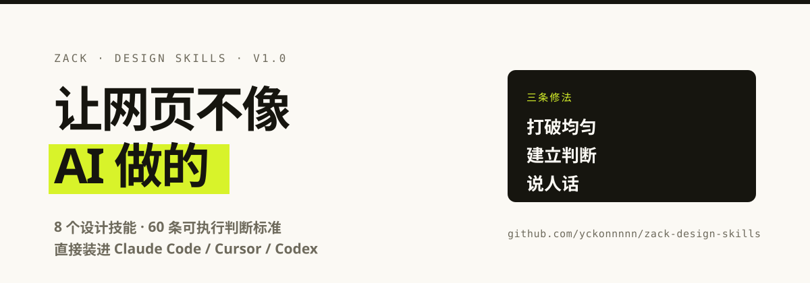
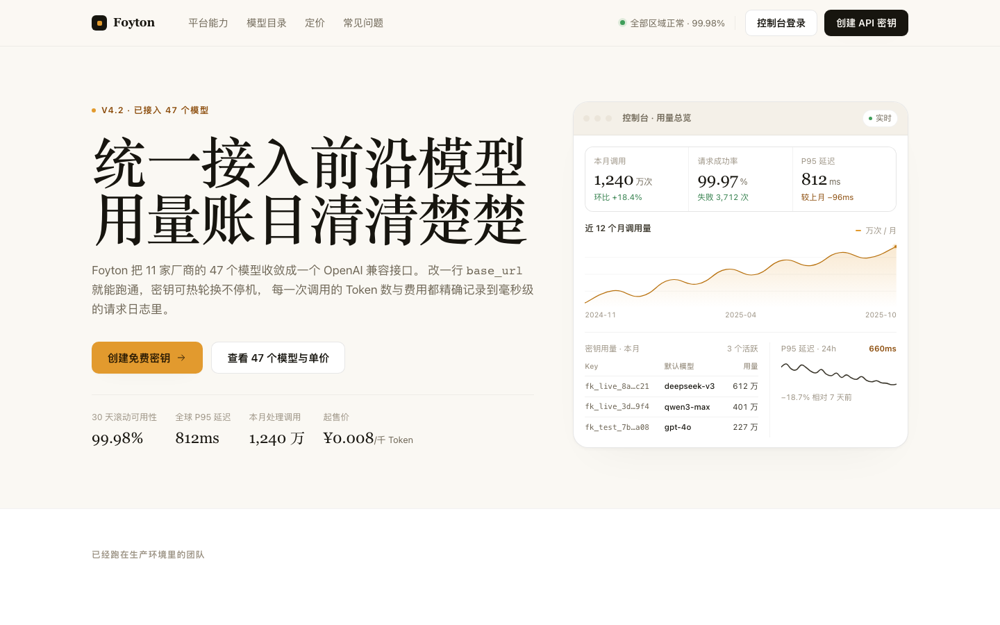

# 让网页不像 AI 做的

<p>
  
  
  
  
</p>



> 一套给 AI 编码工具用的设计技能包。8 个技能，60 条可执行的判断标准，专治「一眼就能看出是 AI 做的」。

**[在线看效果](https://yckonnnnn.github.io/zack-design-skills/)** ｜ **[改前 / 改后直接对比](https://yckonnnnn.github.io/zack-design-skills/examples/before-after/)**

---

## 你的网站，是不是有这些毛病？

不用看代码，看这 8 条，中 3 条以上就该往下读了：

- [ ] 首屏标题在电脑上占了 3 行以上
- [ ] 有渐变文字，或者紫蓝色渐变背景
- [ ] 页面上有「赋能」「触手可及」「开启新时代」
- [ ] 所有东西都是圆角胶囊 + 重阴影
- [ ] 三张一模一样宽的卡片，图标是 emoji
- [ ] 每一屏的上下留白完全一样
- [ ] 价格页写着「—」或者「联系我们」
- [ ] 键盘按 Tab，看不见焦点在哪

**这些不是风格问题，是「没有判断」的证据。**

模型生成界面时会回到训练数据里最高频的那个解——居中的 hero、紫蓝渐变、三张等宽卡片、`shadow-lg`、Inter 字体。每一项单独看都不算错，**叠在一起就成了一种可以一眼识别的平均值**。

这套技能做的事情，就是把这个平均值拆成 60 条可以逐条检查、逐条修掉的规则。

---

## 三条修法

修复方向不是「做得更花」。加更多动效和渐变，只会得到**花哨的 AI 味**。

1. **打破均匀** — 平均值之所以是平均值，因为处处等量。制造不等量：大小、疏密、轻重。
2. **建立判断** — 每个选择都要能回答「为什么是这个值」。答不上来就是默认值，默认值就是 AI 味。
3. **说人话** — 空话是最便宜、也最容易修的 AI 味信号，所以永远排第一。

---

## 里面有什么

| 技能 | 职责 |
|---|---|
| **`zack-design-router`** | 总入口。先判定任务类型，再决定加载哪个技能。防止用错方法做对的事。 |
| **`zack-anti-ai-look`** | 旗舰。60 条 AI 味清单、P0/P1/P2 分级、修复优先级、前后对照。 |
| **`zack-hero-and-pricing`** | 决定转化的两屏：首屏的 7 种形式选择、标题约束、价格档位与锚定、对比表。 |
| **`zack-typography-and-color`** | 字号比例阶梯、流体字号、字体配对、中英混排、6 级中性色阶、阴影配方。 |
| **`zack-layout-and-rhythm`** | 间距尺度、垂直节奏的疏密、bento 网格无空洞排版、10 种版式形式库。 |
| **`zack-motion-taste`** | 该不该动、动什么、动多久、怎么打断、怎么退出。含时长与缓动对照表。 |
| **`zack-figma-to-code`** | Figma MCP 取数顺序 → 令牌映射 → 项目约定翻译 → 1:1 验收。含连接排错。 |
| **`zack-redesign-audit`** | 改版全流程：定范围 → 扫描 → 诊断表 → 最小化修复 → 三宽度验收 → 交付报告。 |

### 看效果

同一个产品、同一份文案、同样的价格和 SLA，两份文件。**左边是 AI 生成的平均水平，右边是按这套规则重写的版本。** 差别不在审美，在有没有做决定。

<table>
<tr>
<th width="50%">改前 · AI 味</th>
<th width="50%">改后 · 有判断</th>
</tr>
<tr>
<td></td>
<td></td>
</tr>
</table>

完整对比页 → **https://yckonnnnn.github.io/zack-design-skills/examples/before-after/** · 源码在 [`examples/before-after/`](examples/before-after/)

带视口切换（桌面 / 笔记本 / 手机）、「只看改前 / 只看改后」开关，以及一张 **21 处最显眼改动**的对照表，每条都写明了「为什么这么改」。也可以直接双击本地的 `examples/before-after/index.html`——不需要服务器、不联网。

---

## 安装

技能是纯 Markdown 文件，不需要构建、不需要依赖。

### Claude Code

```bash
git clone https://github.com/yckonnnnn/zack-design-skills.git ~/.claude/skills/zack-design-skills
# 让 Claude Code 能发现每个技能
cd ~/.claude/skills/zack-design-skills/skills
for d in */; do ln -sfn "$PWD/${d%/}" ~/.claude/skills/"${d%/}"; done
```

### Cursor

```bash
mkdir -p ~/.cursor/skills
git clone https://github.com/yckonnnnn/zack-design-skills.git /tmp/zds
cp -R /tmp/zds/skills/* ~/.cursor/skills/
```

### Codex

```bash
git clone https://github.com/yckonnnnn/zack-design-skills.git /tmp/zds
cp -R /tmp/zds/skills/* ~/.codex/skills/
```

### 其他工具

任何支持「读取本地 Markdown 作为系统提示 / 规则」的工具都能用：

- 只用一个技能：把对应目录下的 `SKILL.md`（连同 `references/`）复制进你的 rules 目录。
- 用一套：把 `skills/zack-design-router/SKILL.md` 作为总规则，其余按需引用。
- 想精简：最小可用集合是 `zack-design-router` + `zack-anti-ai-look`，两个文件就够解决大部分问题。

### 验证安装

```bash
ls ~/.claude/skills/ | grep zack     # 应该看到 8 个 zack-* 目录
```

然后在你的工具里说：

> 帮我看看我这个网站为什么看起来像 AI 做的

命中了，就装对了。

---

## 怎么用

完整配方（20 多条可直接粘贴的提示词）见 [`docs/prompt-recipes.md`](docs/prompt-recipes.md)。下面是四条最常用的。

**诊断一个现有网站**

```
用 zack-anti-ai-look 扫一遍这个项目，出一张诊断表，
标出 P0 的问题，先不要改代码。
```

**新建一个落地页**

```
用 zack-design-router 判断任务类型，然后帮我做这个 API 产品的官网。
先给我首屏的 3 个形式方案，说清各自适合什么，我选一个你再写。
```

**还原 Figma 稿**

```
用 zack-figma-to-code，把这个 Figma 链接的节点实现成 Vue 组件。
先取设计变量，映射到我们现有的 tokens.css，再写代码，最后给我验收报告。
```

**改版**

```
用 zack-redesign-audit。先告诉我你打算改哪几个文件、不改什么，
我确认之后你再动手。
```

---

## 几个别人抄不走的判断标准

这套东西的价值不在「提到要注意排版」，在于**把话说死**：

| 判断 | 具体数字 |
|---|---|
| 首屏标题在 1440px 下最多几行 | **2 行。**超过就是容器太窄，不是字号问题 |
| 一页允许几个字号的强调色 | **1 个。**第二个必须降为中性或语义色 |
| 字号阶梯 | **比例，不是等差。**1.25 密集 / 1.333 通用 / 1.4–1.5 营销页 |
| 区块间距 ÷ 组内间距 | **≥ 3。**达不到就分不出结构，全糊成一片 |
| 阴影总透明度 | **< 0.12**，单层 < 0.06，两层叠加 |
| 微反馈动效时长 | **80–140ms。**一天点 200 次的按钮，每次 300ms 等于浪费用户一分钟 |
| 退出动画 | **比进入快 30–50%。**用户已经决定走了 |
| 改动的净行数 | **通常是负的。**删默认值应该多于加新东西 |
| 一屏解决几个怀疑 | **1 个。**一屏解决多个 = 一个都没解决 |

---

## 设计原则摘要

完整清单在 [`skills/zack-anti-ai-look/references/checklist.md`](skills/zack-anti-ai-look/references/checklist.md)。

**绝对禁止**：渐变文字 · 紫蓝大面积渐变 · Inter/Roboto 当唯一字体 · emoji 当图标 · `FEATURE 01` 元标签 · 三张等宽卡片当唯一版式 · 编造客户名和数据 · 没有 `:focus-visible` · `transition: all` · 交付时不说自己改了什么。

---

## 常见问题

**这跟直接让 AI「设计好看一点」有什么区别？**

「好看一点」没有可执行的含义，模型只会回到默认解。这套东西提供的是可检查的阈值（几行、几个字号、几毫秒、什么比率），所以能被验证、能被返工、能被复现。

**需要什么前置条件？**

不需要。纯 Markdown，不需要 API key、不需要联网、不需要装依赖。`zack-figma-to-code` 需要你已经在用 Figma MCP，但那只影响这一个技能。

**适合什么？**

落地页、官网、营销页、作品集、SaaS 定价页的创建与改版。
不太适合：纯后台数据表格、原生 App 交互细节、游戏 UI。

**会过时吗？**

会被禁用的具体做法（比如渐变文字）会过时，判断标准不会。「区块间距 ÷ 组内间距 ≥ 3」和「高频动效 ≤ 140ms」不依赖任何流行趋势。

---

## 仓库结构

```
zack-design-skills/
├── skills/                       8 个技能，每个一个目录
│   └── zack-*/
│       ├── SKILL.md              主文件（装进工具的就是它）
│       └── references/           深挖内容，按需被引用
├── examples/before-after/        改前 / 改后 对比演示
├── docs/prompt-recipes.md        可直接粘贴的提示词配方
├── scripts/
│   ├── validate_skills.py        结构校验（CI 会跑）
│   ├── screenshots.py            重出预览图，顺带断言零横向溢出
│   ├── traffic_snapshot.py       每日记录 star / 克隆 / 下载量
│   └── make_wechat_card.py       重出群二维码卡片图
├── metrics/traffic.csv           流量与下载量的长期账本
└── CREDITS.md                    上游致谢与第三方许可
```

任何 `SKILL.md` 都是纯文本，你可以直接读、直接改。**改比用更值** —— 把里面的阈值换成你自己项目的标准，它就变成你的了。

---

## 加个群

遇到问题、想看我改稿的过程、或者想让我帮你看一眼你的站，进群说。技能免费，随便拿。

![[AI 技能交流群]](assets/wechat-qr.png)

> 二维码 **2026/10/18 到期**——微信群二维码只有 7 天有效期，这是微信的限制，不是我懒。过期后在这里提个 [Issue](https://github.com/yckonnnnn/zack-design-skills/issues) 我就重发。

---

## 贡献

发现问题、有更好的阈值、或者想加一条规则——直接开 [Issue](https://github.com/yckonnnnn/zack-design-skills/issues) 或 PR。

提规则的时候请带上**具体数字和判断条件**。「颜色要更高级」这种不算规则；「一页只允许 1 个颜色承担强调职责，第二个必须降为语义色」才算。

---

## License

MIT — 随便用、随便改、可以商用。

上游致谢与第三方声明见 [CREDITS.md](CREDITS.md)。
